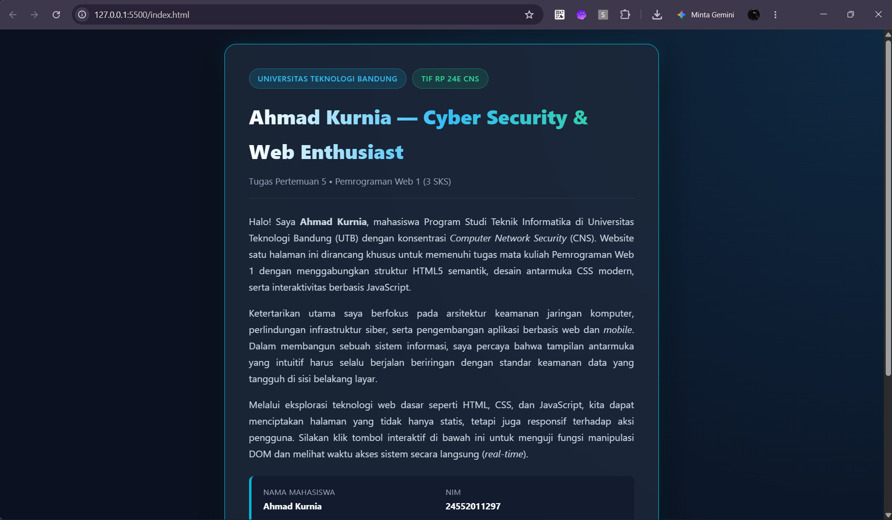
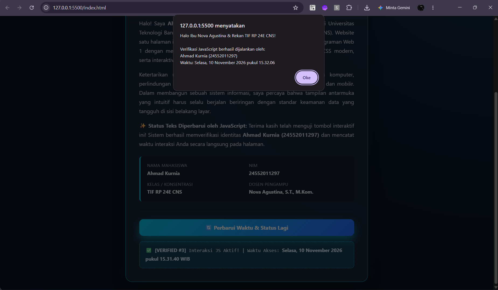

# 🌐 Tugas Pertemuan 5 - Pemrograman Web 1

Repositori ini berisi proyek pembuatan **Website 1 Halaman (Single-File HTML)** yang menggabungkan struktur HTML, desain CSS, dan interaktivitas JavaScript.

---

## 👨‍💻 Identitas Mahasiswa

| Atribut | Keterangan |
| :--- | :--- |
| **Nama Lengkap** | Ahmad Kurnia |
| **NIM** | 24552011297 |
| **Kelas** | TIF RP 24E CNS |
| **Mata Kuliah** | Pemrograman Web I (3 SKS) |
| **Dosen Pengampu** | Nova Agustina, S.T., M.Kom. |
| **Institusi** | Universitas Teknologi Bandung (UTB) |

---

## ✅ Pemenuhan Syarat Tugas

1. **Tampilan (HTML + CSS)**
   - **Judul Halaman (`<title>`):** `Ahmad Kurnia`
   - **Minimal 4 Teks:** Terdiri dari 1 Heading utama (`<h1>`) dan 3 Paragraf (`
`).
   - **Elemen Desain:** Menggunakan tema *Cyber Security Dark Glassmorphism* dengan *radial gradient background*, tipografi modern, serta *card border glow*.
2. **Interaksi (JavaScript)**
   - Memiliki **1 tombol interaktif** (`#actionBtn`) yang ketika diklik menjalankan fungsi `jalankanInteraksi()` untuk:
     - Menampilkan pesan *pop-up* (`alert`).
     - Menampilkan tanggal dan jam *real-time* ke halaman web.
     - Mengubah teks paragraf dan panel status secara dinamis.

---

## 📸 Screenshot Tampilan di Browser

